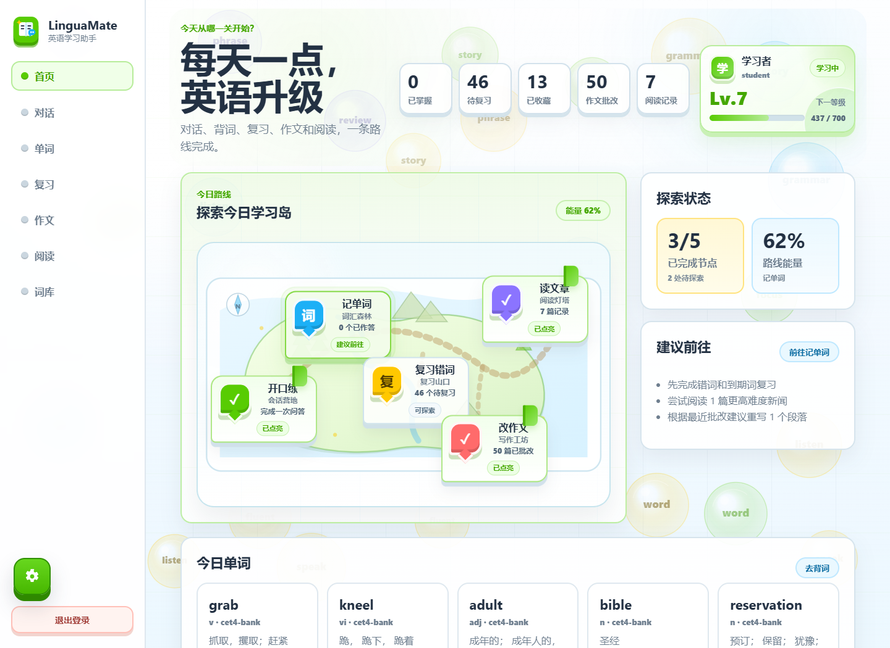
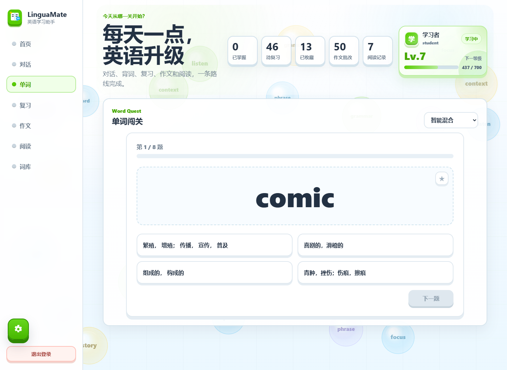
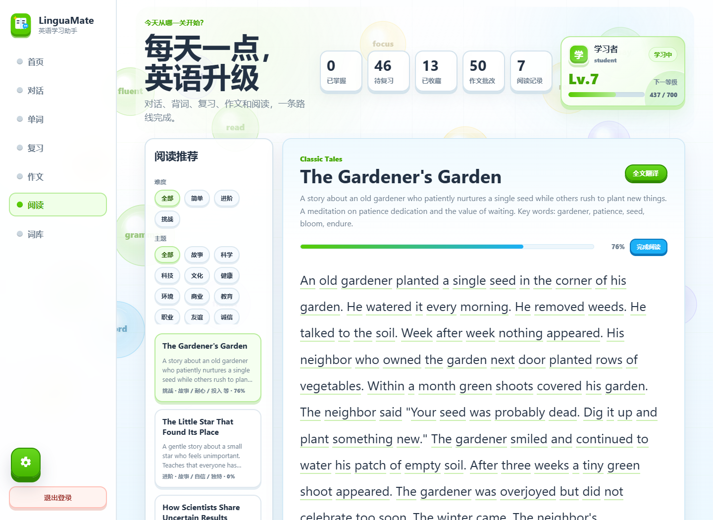

# LinguaMate Agent

LinguaMate Agent 是一个基于 Spring Boot 的英语学习助手，面向 Java 课程设计与完整 Web 应用演示场景。项目把对话练习、词汇闯关、复习计划、作文批改、分级阅读、轻量 RAG 和可解释 Agent 流程整合到一个学习工作台中。

默认可以在没有真实模型密钥的情况下运行：AI 对话、作文批改、词汇解析等能力在在线调用失败时会自动降级到本地规则或种子数据，便于课堂展示、答辩和本地开发。

## 项目亮点

- 每日主题任务：校园节水科普与迎新向导，串联阅读、主题词、分级提示、AI 情境表达和个人复盘，按账号与日期续做。
- 可回看的成长证据：保留实际作答、再次表达、提示使用、作文原稿与学习者改写；详见 [主题任务说明](docs/DAILY_MISSIONS.md)。
- 可解释 Agent 流程：每轮问答保留 Observe、Think、Act、Answer 四阶段轨迹。
- 英语对话练习：支持日常、面试、考试、旅行等场景，并结合知识库检索生成反馈。
- 单词学习与复习：内置 CET-4、CET-6、考研、雅思词库，支持闯关、收藏、掌握状态、错词复习。
- 作文智能批改：提供总分、维度评分、修改建议和本地 fallback。
- 分级阅读助手：内置阅读材料、主题筛选、阅读进度、悬停查词、全文翻译。
- 轻量 RAG：基于 seeded knowledge documents 的关键词检索，适合课程项目展示检索增强流程。
- 后台管理：管理员可维护用户、阅读文章、词库与学习数据概览。
- OpenAI 兼容接入：支持配置 base URL、API key、chat model，也可接入兼容接口。

## 截图

### 学习工作台



### 单词闯关



### 阅读助手



## 技术栈

- Java 17
- Spring Boot 3.5.3
- Maven Wrapper
- MyBatis-Plus 3.5.7
- MySQL 8 兼容数据库
- Spring AI 依赖与自定义 OpenAI-compatible REST client
- Vue 3、Vite、Element Plus
- Vanilla static hosting through Spring Boot

## 快速启动

### 1. 准备数据库

创建 MySQL 数据库，或使用默认连接中的 `createDatabaseIfNotExist=true` 让应用自动创建 `linguamate` 数据库。默认配置位于 `src/main/resources/application.properties`。

常用环境变量：

```powershell
$env:DB_USER="root"
$env:DB_PASSWORD="your-local-password"
$env:DB_URL="jdbc:mysql://localhost:3306/linguamate?createDatabaseIfNotExist=true&useSSL=false&serverTimezone=Asia/Shanghai&allowPublicKeyRetrieval=true&characterEncoding=utf-8"
```

### 2. 可选配置 AI 服务

```powershell
$env:LINGUAMATE_AI_BASE_URL="https://api.openai.com/v1"
$env:LINGUAMATE_AI_API_KEY="your-api-key"
$env:LINGUAMATE_AI_CHAT_MODEL="gpt-4o-mini"
$env:LINGUAMATE_GNEWS_API_KEY="your-gnews-api-key"
```

不配置 API key 也可以启动，应用会使用本地 fallback。

### 3. 启动后端

```powershell
.\mvnw.cmd spring-boot:run
```

默认访问地址：

```text
http://localhost:4040
```

演示账号：

```text
普通用户：student / student123
管理员：admin / admin123
```

## 前端开发

前端源码位于 `frontend/`，生产构建输出到 `src/main/resources/static`，由 Spring Boot 统一托管。

```powershell
cd frontend
npm install
npm run dev
```

构建静态资源：

```powershell
cd frontend
npm run build
cd ..
```

也可以通过 Maven profile 构建前端并打包：

```powershell
.\mvnw.cmd -Pfrontend-build package
```

## Docker 运行

```powershell
$env:DB_PASSWORD="your-local-password"
docker compose up --build
```

Docker 场景下数据库初始化脚本由容器处理，应用侧 SQL 初始化可通过 `DB_INIT_MODE` 控制。

## 测试

```powershell
.\mvnw.cmd test
```

集成测试使用 MockMvc，并把模型接口指向不可用地址，用来验证本地 fallback 行为，不需要真实模型密钥。

## 项目结构

```text
src/main/java/com/example/javabigwork
  admin/        管理后台 API 与聚合服务
  agent/        Agent 编排、提示词、轨迹记录、记忆
  ai/           OpenAI 兼容配置、DTO、持久化、REST client
  auth/         登录注册、会话鉴权、角色与当前用户上下文
  chat/         对话 API、消息与会话持久化
  common/       ApiResponse、PageResponse、异常处理
  config/       数据源、MyBatis、Web、AI、RAG、迁移配置
  dictionary/   本地/在线查词与翻译支持
  knowledge/    知识文档、切块、关键词检索
  news/         阅读文章、阅读记录、推荐、悬停查词
  report/       学习报告汇总
  tool/         Agent 工具调用
  ui/           页面路由
  vocabulary/   词库、闯关、收藏、进度、复习计划
  writing/      作文提交、评分、反馈、AI 批改

frontend/       Vue 3 + Vite 前端工程
docs/           架构、部署、RAG 和测试文档
scripts/        工具脚本
```

## 文档

- [部署说明](docs/DEPLOYMENT.md)
- [项目架构](docs/PROJECT_ARCHITECTURE.md)
- [Spring AI 与 RAG 说明](docs/SPRING_AI_AND_RAG_NOTES.md)
- [测试报告](docs/TEST_REPORT.md)
