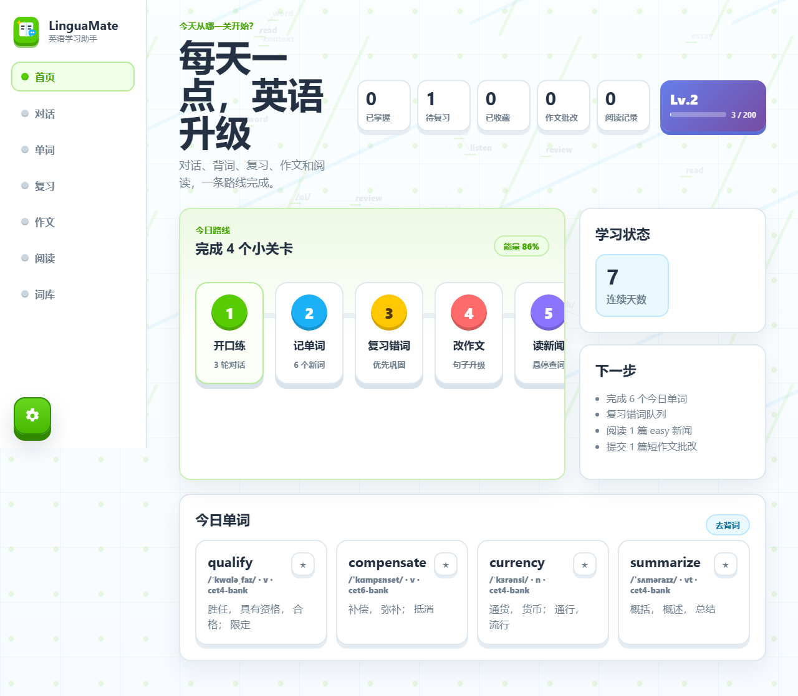

# LinguaMate Agent

LinguaMate Agent is a Spring Boot based English learning assistant for Java advanced application coursework. It combines an explainable agent loop, lightweight RAG, tool calls, vocabulary practice, writing review, news reading, and a responsive single-page UI.



## Features

- Agent loop: records Observe, Think, Act, and Answer steps for user-facing traceability.
- English conversation practice: daily, interview, exam, and travel scenarios with contextual feedback.
- Vocabulary learning: CET-4/CET-6 word bank, daily quiz, favorites, mastered words, and review scheduling.
- Writing review: local scoring fallback plus optional OpenAI-compatible model review.
- Reading assistant: graded news, hover word lookup, translation, and reading records.
- Lightweight RAG: keyword-based knowledge retrieval from seeded writing and grammar documents.
- Tool calling: dictionary lookup, essay scoring, review planning, news recommendation, and retrieval services.

## Tech Stack

- Java 17
- Spring Boot 3.5.3
- Maven Wrapper
- MyBatis-Plus 3.5.7
- MySQL 8 compatible database
- Spring AI dependencies
- OpenAI-compatible chat API client
- Vanilla HTML, CSS, and JavaScript SPA

## Project Structure

```text
src/main/java/com/example/javabigwork
  agent/        Agent orchestration, prompts, trace recording, memory
  ai/           OpenAI-compatible settings and chat client
  chat/         Conversation APIs and persistence
  common/       API response wrappers and global exception handling
  config/       AI, datasource, MyBatis, RAG, and web config
  dictionary/   Local and external dictionary services
  knowledge/    Knowledge documents, chunking, and retrieval
  news/         News recommendation, reading assistance, and translation
  report/       Learning report summary
  tool/         Agent tools exposed to the orchestrator
  ui/           Page routing
  vocabulary/   Word bank, quiz, favorites, review scheduling
  writing/      Essay submission, scoring, feedback, and AI review
src/main/resources
  static/       Frontend assets
  schema.sql    Database schema
  data.sql      Seed data
  word-bank/    CET vocabulary source files
docs/           Architecture, RAG notes, test report, deployment guide
scripts/        Utility scripts
```

## Requirements

- JDK 17
- MySQL 8.x or a MySQL-compatible local database
- Network access for first Maven dependency download
- Optional: an OpenAI-compatible model provider API key

## Quick Start

1. Create a local MySQL database user that can create the `linguamate` database, or update the datasource settings in `src/main/resources/application.properties`.
2. Set optional AI environment variables:

```powershell
$env:LINGUAMATE_AI_BASE_URL="https://api.openai.com/v1"
$env:LINGUAMATE_AI_API_KEY="your-api-key"
$env:LINGUAMATE_AI_CHAT_MODEL="gpt-4o-mini"
$env:LINGUAMATE_GNEWS_API_KEY="your-gnews-api-key"
```

3. Start the application:

```powershell
.\mvnw.cmd spring-boot:run
```

4. Open the app:

```text
http://localhost:4040
```

The application can still run without an AI key. Conversation and writing features use local fallback behavior when the configured model endpoint is unavailable.

## Tests

Run the integration tests with:

```powershell
.\mvnw.cmd test
```

The tests intentionally point the model URL to an unavailable local port, so the suite validates local fallback behavior without requiring a real API key.

## Configuration

Main runtime settings live in `src/main/resources/application.properties`:

```properties
server.port=4040
spring.datasource.url=jdbc:mysql://localhost:3306/linguamate?createDatabaseIfNotExist=true&useSSL=false&serverTimezone=Asia/Shanghai&allowPublicKeyRetrieval=true&characterEncoding=utf-8
linguamate.ai.base-url=${LINGUAMATE_AI_BASE_URL:https://api.openai.com/v1}
linguamate.ai.api-key=${LINGUAMATE_AI_API_KEY:}
linguamate.ai.chat-model=${LINGUAMATE_AI_CHAT_MODEL:gpt-4o-mini}
linguamate.news.gnews-api-key=${LINGUAMATE_GNEWS_API_KEY:}
```

The frontend settings panel can also update the OpenAI-compatible base URL, API key, and model name at runtime.
The GNews key is optional; without it, the built-in seeded reading articles still work.

## Documentation

- [Deployment Guide](docs/DEPLOYMENT.md)
- [Project Architecture](docs/PROJECT_ARCHITECTURE.md)
- [Spring AI and RAG Notes](docs/SPRING_AI_AND_RAG_NOTES.md)
- [Test Report](docs/TEST_REPORT.md)
