# 语伴智学（LinguaMate）

**基于 AI Agent 的个性化英语学习平台**

作者：庄鹏桦 · 作品方向：智慧教育与科普创作 · 当前面向电脑网页端

语伴智学将英语阅读、词汇练习、AI 对话、写作修改和个人成长记录放在同一套学习工作区中。

## 项目亮点

- **学习概览**：今日待办根据实际学习记录更新，可任选任务开始。「下一步」按顺序推荐尚未完成的任务，首页也展示今日单词和近七天学习足迹。
- **AI 对话教练**：日常交流、考试口语、商务表达、阅读讨论四个入口，围绕会话上下文提供原句反馈、可复用短语和下一轮挑战。
- **个性化学习助手**：结合当前账号的今日进度和优先巩固词回答学习问题，说明推荐依据，并承接练习时长等连续追问。
- **单词练习与复习**：内置 CET-4、CET-6、考研、雅思词库，支持新词专项练习。作答后在底栏查看反馈，按需展开完整释义、例句译文和深度解析。到期词与错词分别复习。
- **阅读空间**：难度和主题筛选、即时查词与词形还原、句子聚焦、全文翻译，遇到的词可以加入待复习，当前文章可以带入 AI 讨论。
- **写作工坊**：四维参考评分、逐句批注和润色对照，支持学习者主动改写并再次提交，分别保留原稿与 AI 参考。
- **词库与成长档案**：统一管理收藏词、错词、待复习和掌握状态，以手绘成长树、活动图表与日历回看记录，并打开原始作答与改写证据。
- **Agent 与轻量 RAG**：保留 Observe、Think、Act、Answer 执行记录，对知识分块进行关键词检索，并在回答中使用相关材料。
- **管理与模型接入**：后台维护用户、词库、知识文档及阅读材料。学习者与管理员使用各自的 OpenAI-compatible 模型配置，在线失败时明确降级。

## 页面展示

以下图片来自早期版本的桌面演示账号。统计数字用于展示功能，模型无法使用时，界面会标注本地练习或本地规则批改。

<details>
<summary>登录与黑夜模式</summary>

### 登录入口

统一中英文品牌，保留交互单词与动态背景。

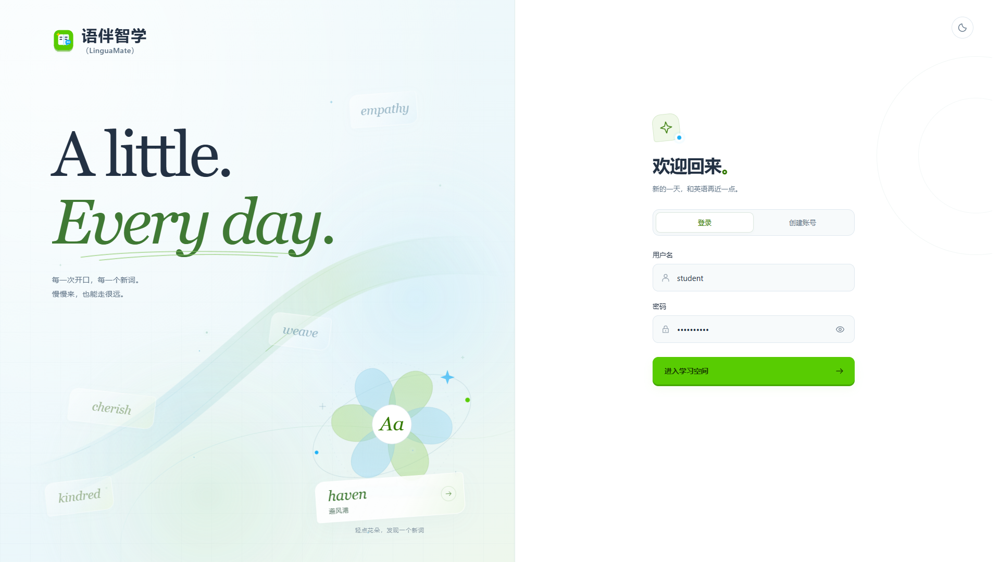

### 黑夜模式

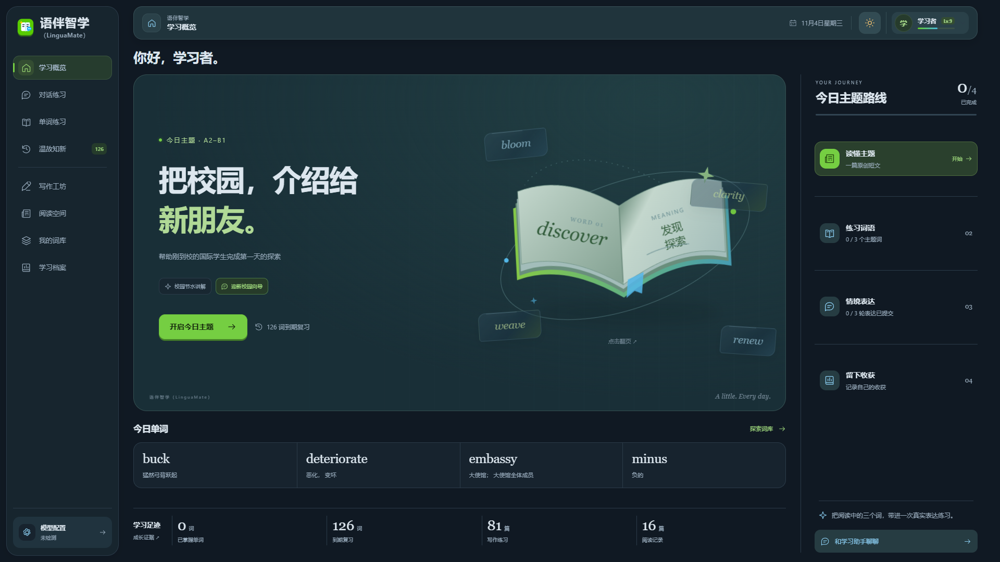

</details>

<details>
<summary>AI 对话教练与个人学习助手</summary>

### AI 对话练习

对话与本轮反馈并列呈现，原句、修改理由、短语和下一轮挑战可以分别查看。

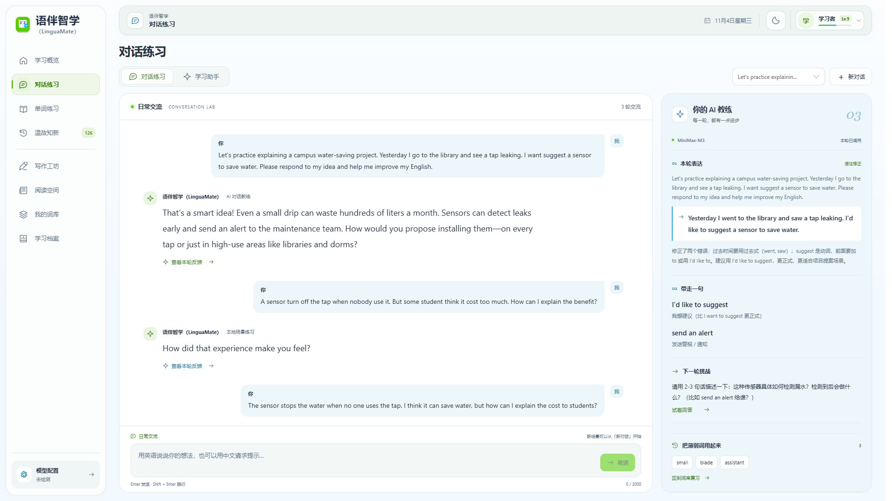

### 学习助手

依据当前账号的学习记录提供建议，继续追问可以限定练习时长。

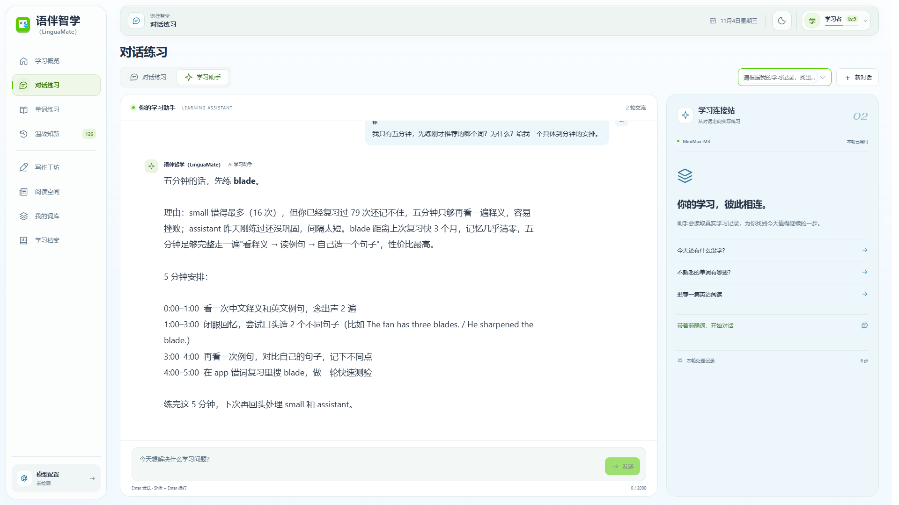

</details>

<details>
<summary>单词练习、复习、阅读与我的词库</summary>

### 单词练习

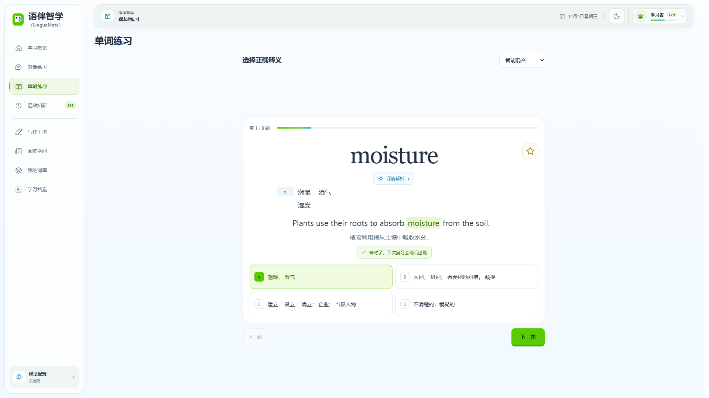

### 温故知新

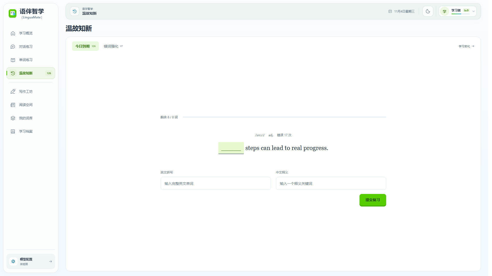

### 阅读空间

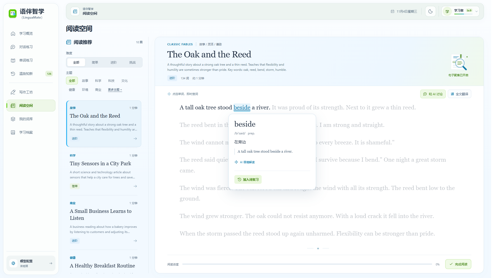

### 我的词库

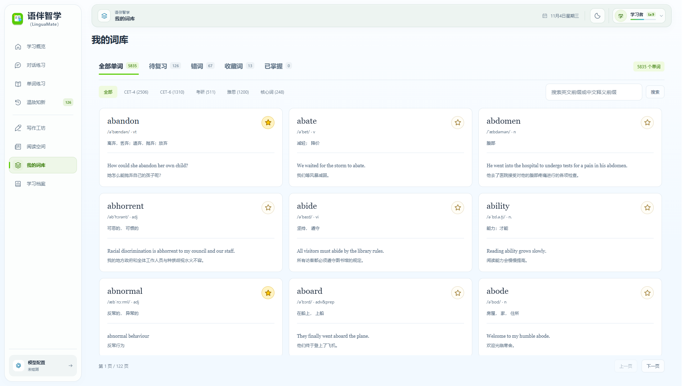

</details>

<details>
<summary>写作、成长证据与管理后台</summary>

### 写作工坊

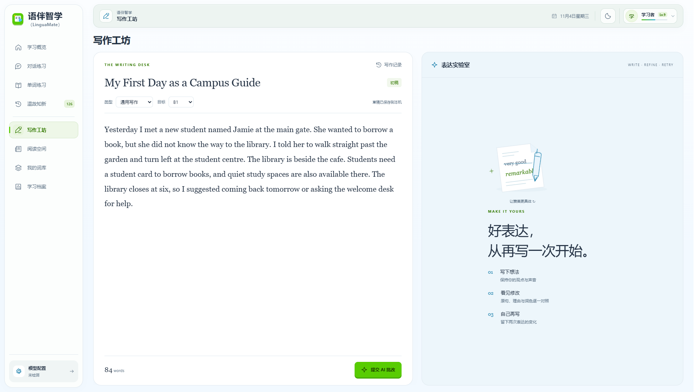

### 学习档案

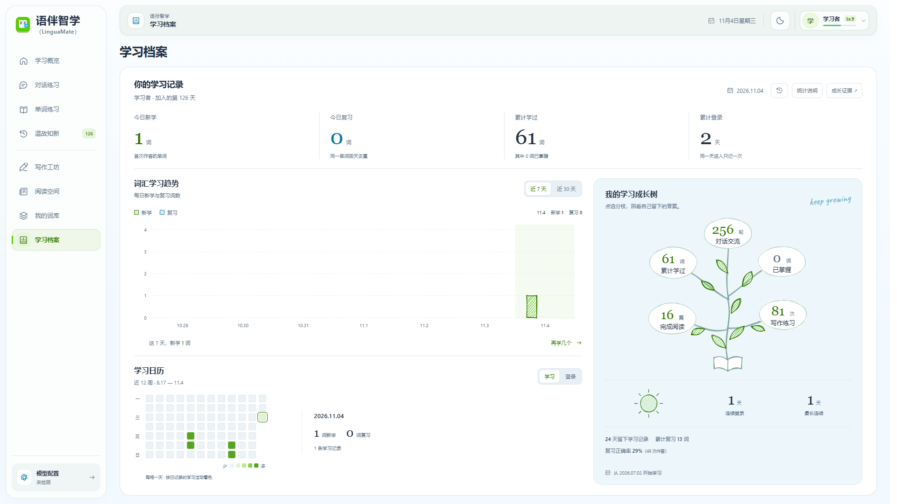

### 成长证据

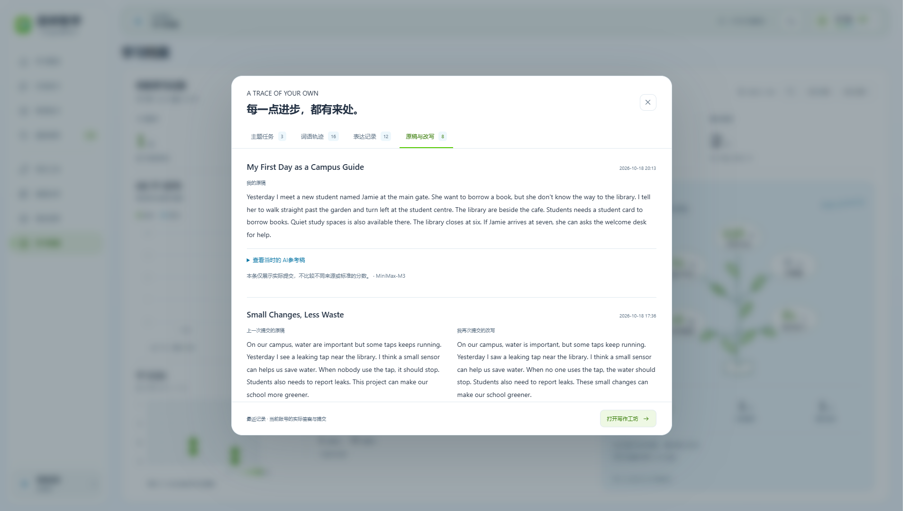

### 管理后台

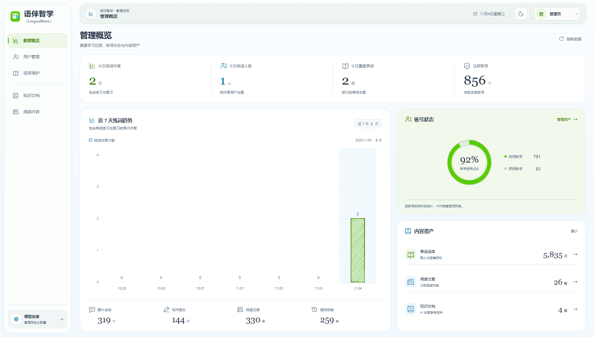

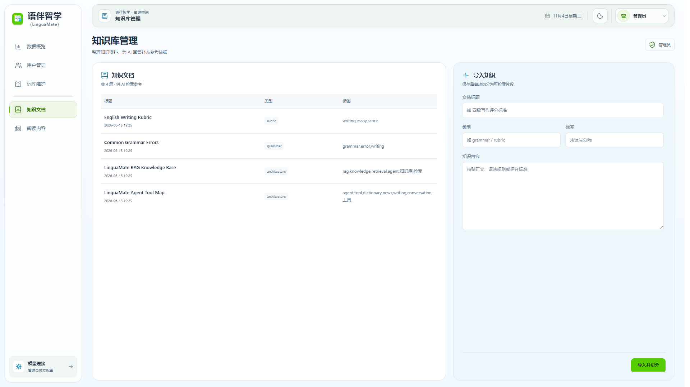

</details>

## 技术栈

- Java 17
- Spring Boot 3.5.3
- Maven Wrapper
- MyBatis-Plus 3.5.7
- MySQL 8 兼容数据库
- Spring AI 依赖与自定义 OpenAI-compatible REST client
- Vue 3、Vite、Element Plus、Rough.js 手绘图表
- 前后端独立运行：Vue/Vite 前端与 Spring Boot API，浏览器通过前端代理访问后端

## 快速启动

需要 Java 17+、Node.js 20.19+ 或 22.12+、MySQL 8 兼容数据库。

在 Windows 项目根目录执行，也可以双击：

```powershell
.\start.cmd
```

脚本检查环境、安装锁定的前端依赖、按后端源码变化构建 JAR，启动数据库、后端和 Vite，并在就绪后打开浏览器。首次构建需要联网下载依赖。

- 网页入口：`http://127.0.0.1:5173`
- 后端 API：`http://127.0.0.1:4040/api`
- 后端就绪检查：`http://127.0.0.1:4040/actuator/health/readiness`
- 学生账号：`student / student123`
- 管理员账号：`admin / admin123`

停止前后端：

```powershell
.\stop.cmd
```

MySQL 独立保存数据。脚本的进程记录、日志、构建指纹和个人配置位于 Git 忽略的 `.runtime/`。后端源码或前端依赖更新后，执行 `stop.cmd` 再执行 `start.cmd`。前端页面修改通过 Vite 自动更新。

### 数据库与端口

本机已有的 Windows 加密 MySQL 配置可以直接复用。换到一台已安装 MySQL 8 的 Windows 电脑时，可初始化专属的本地数据库实例：

```powershell
powershell.exe -NoProfile -ExecutionPolicy Bypass -File scripts/setup-local-db.ps1
```

专属数据库默认监听 `127.0.0.1:34061`，持久化数据与加密凭据存放于 `%LOCALAPPDATA%\LinguaMate`。也可以使用已有数据库，在执行启动脚本前设置 `DB_URL`、`DB_USER` 和 `DB_PASSWORD`。数据库地址应包含完整 JDBC 参数，示例见 `scripts/local.config.example.ps1`。

可复制配置示例到 `.runtime/config.ps1`，设置后端 `SERVER_PORT`、前端 `FRONTEND_PORT` 或数据库连接。真实密钥应从环境变量或本机加密凭据加载。

### AI 配置

登录后在「模型配置」中设置兼容接口地址、密钥与模型，按账号保存。也支持 `LINGUAMATE_AI_BASE_URL`、`LINGUAMATE_AI_API_KEY`、`LINGUAMATE_AI_CHAT_MODEL` 和 `LINGUAMATE_GNEWS_API_KEY` 环境变量。未配置模型时使用明确标识的本地练习与规则批改。

## 前后端独立开发

独立启动后端前，先配置所用数据库的 `DB_*` 环境变量，再在项目根目录执行：

```powershell
.\mvnw.cmd spring-boot:run
```

前端在 `frontend/` 执行：

```powershell
npm ci
npm run dev
```

`frontend/vite.config.js` 将 `/api` 代理到后端。前端配置示例见 `frontend/.env.example`。生产构建执行 `npm run build`，输出仅在 `frontend/dist/`，可由独立 Web 服务托管。本地预览构建产物可执行 `npm run preview`，该预览也配置了 API 代理。

后端 Maven 独立打包，仅包含 Java API 与数据库、词典等后端资源。前端功能模块位于 `frontend/src/features/`，管理工作台也按六个功能区域分组。架构审查与边界见 [架构审查](docs/ARCHITECTURE_REVIEW.md)。

## Docker 运行

```powershell
$env:DB_PASSWORD="your-database-password"
docker compose up --build
```

Compose 分别构建前端 Nginx 与 Java API 镜像，连同 MySQL、Redis 一起启动。网页访问 `http://localhost:5173`。Nginx 将 `/api` 转发给后端，并为前端路由提供刷新回退。部署配置见 [部署说明](docs/DEPLOYMENT.md)。

## 测试

```powershell
.\mvnw.cmd test
cd frontend
npm test
npm run build
cd ..
```

集成测试使用 MockMvc，并把模型接口指向不可用地址，用来验证本地 fallback 行为，不需要真实模型密钥。

## 项目结构

```text
src/main/java/com/example/javabigwork
  admin/        管理后台 API 与聚合服务
  agent/        Agent 编排、提示词、轨迹记录、记忆
  ai/           OpenAI 兼容配置、DTO、持久化、REST client
  auth/         登录注册、会话鉴权、角色与当前用户上下文
  chat/         对话 API、消息与会话持久化
  common/       ApiResponse、PageResponse、异常处理
  config/       数据源、MyBatis、Web、AI、RAG、迁移配置
  dictionary/   本地/在线查词与翻译支持
  knowledge/    知识文档、切块、关键词检索
  mission/      旧版专题服务，默认停用
  news/         阅读文章、阅读记录、推荐、悬停查词
  report/       学习报告汇总
  tool/         Agent 工具调用
  vocabulary/   词库、闯关、收藏、进度、复习计划
  writing/      作文提交、评分、反馈、AI 批改

frontend/       Vue 3 + Vite 前端工程
docs/           架构、部署、RAG 和测试文档
scripts/        工具脚本
```

## 文档

- [部署说明](docs/DEPLOYMENT.md)
- [项目架构](docs/PROJECT_ARCHITECTURE.md)
- [学习工作区说明](docs/LEARNING_WORKSPACE.md)
- [旧版专题任务与成长证据设计](docs/DAILY_MISSIONS.md)
- [Spring AI 与 RAG 说明](docs/SPRING_AI_AND_RAG_NOTES.md)
- [测试报告](docs/TEST_REPORT.md)
