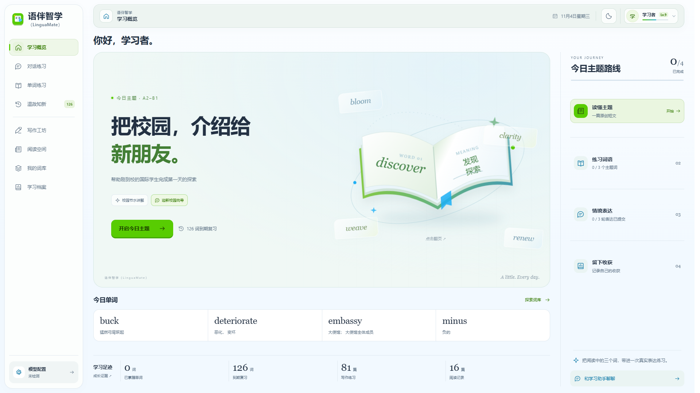
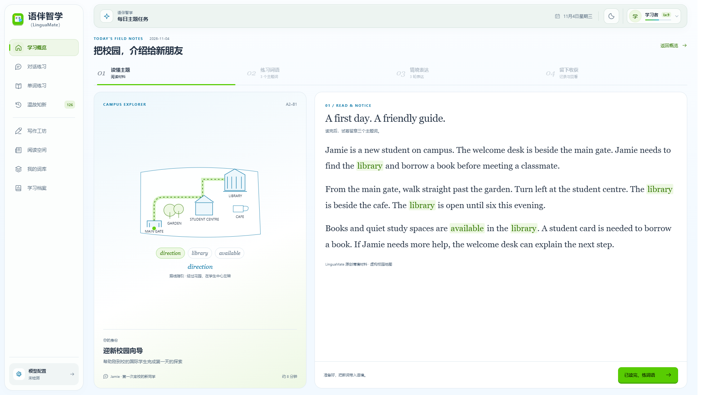

# 语伴智学（LinguaMate）

**基于 AI Agent 的个性化英语学习平台**

作者：庄鹏桦 · 作品方向：智慧教育与科普创作 · 当前面向电脑网页端

语伴智学将主题阅读、词汇练习、AI 对话、写作修改和个人成长记录放在同一套学习工作区中。学习者可以围绕具体情境练习英语，理解对应原句的反馈，再用自己的话表达一次。



> 页面截图来自本地演示账号，统计数字用于展示功能，不代表真实运营规模或教学效果。对话截图展示已保存的模型演示记录；写作截图展示原稿编辑，成长证据展示真实提交的版本。模型无法使用时，界面会明确标注本地练习或本地规则批改。

## 项目亮点

- **每日主题任务**：迎新校园向导、校园节水讲解两套精编情境，串联阅读、三个主题词、三轮表达、分级提示和个人复盘，支持按账号与日期续做。
- **AI 对话教练**：日常交流、考试口语、商务表达、阅读讨论四个入口，围绕会话上下文提供原句反馈、可复用短语和下一轮挑战。
- **个性化学习助手**：结合当前账号的今日进度和优先巩固词回答学习问题，说明推荐依据，并承接练习时长等连续追问。
- **单词练习与复习**：内置 CET-4、CET-6、考研、雅思词库。作答后展示完整词性与释义，补充解析按需展开；今日到期与错词强化分别安排。
- **阅读空间**：难度和主题筛选、即时查词与词形还原、句子聚焦、全文翻译，遇到的词可以加入待复习，当前文章可以带入 AI 讨论。
- **写作工坊**：四维参考评分、逐句批注和润色对照，支持学习者主动改写并再次提交，分别保留原稿与 AI 参考。
- **词库与成长档案**：统一管理收藏词、错词、待复习和掌握状态，以手绘成长树、活动图表与日历回看记录，并打开原始作答与改写证据。
- **Agent 与轻量 RAG**：保留 Observe、Think、Act、Answer 执行记录，对知识分块进行关键词检索，并在回答中使用相关材料。
- **管理与模型接入**：后台维护用户、词库、知识文档及阅读材料。学习者与管理员使用各自的 OpenAI-compatible 模型配置，在线失败时明确降级。

当前主题为两套精编材料，并非每天自动生成。词语出现核对不等于掌握判定，模型评分也不作为长期教学成效的证明。详见 [主题任务与成长证据](docs/DAILY_MISSIONS.md)。

## 页面展示

以下图片为 1920 × 1080 桌面网页实拍，点击图片可查看原图。

<details>
<summary>登录、黑夜模式与迎新主题</summary>

### 登录入口

统一中英文品牌，保留交互单词与动态背景。


### 黑夜模式


### 迎新校园向导

根据校园地图、借阅条件与开放时间，完成有具体目标的英语练习。



</details>

<details>
<summary>AI 对话教练与个人学习助手</summary>

### AI 对话练习

对话与本轮反馈并列呈现，原句、修改理由、短语和下一轮挑战可以分别查看。


### 学习助手

依据当前账号的学习记录提供建议，继续追问可以限定练习时长。


</details>

<details>
<summary>单词练习、复习、阅读与我的词库</summary>

### 单词练习


### 温故知新


### 阅读空间


### 我的词库


</details>

<details>
<summary>写作、成长证据与管理后台</summary>

### 写作工坊


### 学习档案


### 成长证据


### 管理后台


</details>

## 技术栈

- Java 17
- Spring Boot 3.5.3
- Maven Wrapper
- MyBatis-Plus 3.5.7
- MySQL 8 兼容数据库
- Spring AI 依赖与自定义 OpenAI-compatible REST client
- Vue 3、Vite、Element Plus、Rough.js 手绘图表
- Spring Boot 托管 Vite 构建后的静态资源

## 快速启动

### 1. 准备环境与数据库

需要 Java 17+、MySQL 8 兼容数据库。修改前端时还需要满足 Vite 7 要求的 Node.js 环境（20.19+ 或 22.12+）。

创建 MySQL 数据库，或使用默认连接中的 `createDatabaseIfNotExist=true` 让应用自动创建 `linguamate` 数据库。默认配置位于 `src/main/resources/application.properties`。

常用环境变量：

```powershell
$env:DB_USER="root"
$env:DB_PASSWORD="your-local-password"
$env:DB_URL="jdbc:mysql://localhost:3306/linguamate?createDatabaseIfNotExist=true&useSSL=false&serverTimezone=Asia/Shanghai&allowPublicKeyRetrieval=true&characterEncoding=utf-8"
```

### 2. 配置 AI 服务（可选）

登录后，可在左下角“模型配置”中填写兼容接口地址、密钥并选择模型。配置按账号保存，管理员有独立入口。

也可通过环境变量提供服务端默认配置：

```powershell
$env:LINGUAMATE_AI_BASE_URL="https://api.openai.com/v1"
$env:LINGUAMATE_AI_API_KEY="your-api-key"
$env:LINGUAMATE_AI_CHAT_MODEL="your-compatible-chat-model"
$env:LINGUAMATE_GNEWS_API_KEY="your-gnews-api-key"
```

未连接模型也可以启动并查看本地材料、查词和练习流程，在线失败时使用明确标注的本地降级。个人 AI 配置与运行数据库不随仓库上传。

### 3. 启动后端

```powershell
.\mvnw.cmd spring-boot:run
```

默认访问地址：

```text
http://localhost:4040
```

演示账号：

```text
普通用户：student / student123
管理员：admin / admin123
```

## 前端开发

前端源码位于 `frontend/`，生产构建输出到 `src/main/resources/static`，由 Spring Boot 统一托管。

```powershell
cd frontend
npm install
npm run dev
```

构建静态资源（修改前端后必须重新构建）：

```powershell
cd frontend
npm run build
cd ..
```

也可以通过 Maven profile 构建前端并打包：

```powershell
.\mvnw.cmd -Pfrontend-build package
```

## Docker 运行

```powershell
$env:DB_PASSWORD="your-local-password"
docker compose up --build
```

Docker 场景下数据库初始化脚本由容器处理，应用侧 SQL 初始化可通过 `DB_INIT_MODE` 控制。当前 Dockerfile 使用仓库中的静态资源，修改前端后应先运行 `npm run build`，再重建镜像。

## 测试

```powershell
.\mvnw.cmd test
cd frontend
npm test
npm run build
cd ..
```

集成测试使用 MockMvc，并把模型接口指向不可用地址，用来验证本地 fallback 行为，不需要真实模型密钥。

## 项目结构

```text
src/main/java/com/example/javabigwork
  admin/        管理后台 API 与聚合服务
  agent/        Agent 编排、提示词、轨迹记录、记忆
  ai/           OpenAI 兼容配置、DTO、持久化、REST client
  auth/         登录注册、会话鉴权、角色与当前用户上下文
  chat/         对话 API、消息与会话持久化
  common/       ApiResponse、PageResponse、异常处理
  config/       数据源、MyBatis、Web、AI、RAG、迁移配置
  dictionary/   本地/在线查词与翻译支持
  knowledge/    知识文档、切块、关键词检索
  mission/      每日主题、情境作答、提示与复盘
  news/         阅读文章、阅读记录、推荐、悬停查词
  report/       学习报告汇总
  tool/         Agent 工具调用
  ui/           页面路由
  vocabulary/   词库、闯关、收藏、进度、复习计划
  writing/      作文提交、评分、反馈、AI 批改

frontend/       Vue 3 + Vite 前端工程
docs/           架构、部署、RAG 和测试文档
scripts/        工具脚本
```

## 文档

- [部署说明](docs/DEPLOYMENT.md)
- [项目架构](docs/PROJECT_ARCHITECTURE.md)
- [学习工作区说明](docs/LEARNING_WORKSPACE.md)
- [每日主题与成长证据](docs/DAILY_MISSIONS.md)
- [Spring AI 与 RAG 说明](docs/SPRING_AI_AND_RAG_NOTES.md)
- [测试报告](docs/TEST_REPORT.md)
