# 语伴智学（LinguaMate）

**把英语词汇、对话、阅读和写作放进同一个学习工作区。**

作者 · 庄鹏桦｜作品方向 · 智慧教育与科普创作｜使用端 · 桌面网页

语伴智学是一套基于 AI Agent 的个性化英语学习平台。学习者可以从首页任选一项任务开始，在例句中练词，围绕文章和 AI 对话，或者提交自己的英文作文。练习会留下可回看的记录，方便下次接着学，也能看到自己曾经答错的词、调整过的表达和提交过的文章版本。

[功能速览](#功能速览) · [页面展示](#页面展示) · [AI 如何参与学习](#ai-如何参与学习) · [快速启动](#快速启动) · [开发与测试](#开发与测试)

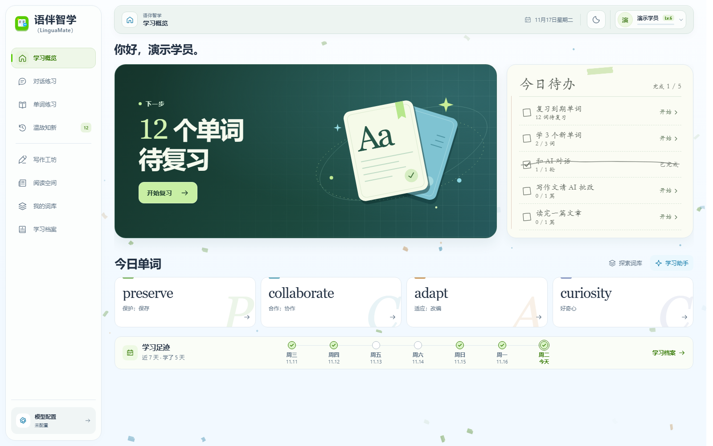

## 功能速览

| 模块 | 可以做什么 |
| --- | --- |
| **学习概览** | 从到期复习、新词、对话、写作和阅读中任选一项。完成情况根据实际学习记录更新。「下一步」按顺序提示尚未完成的任务，下方显示今日单词和最近七天的学习足迹。 |
| **单词练习** | 从 CET-4、CET-6、考研、雅思词库或智能混合题组练习。在例句里选释义，作答后查看正误、例句译文和完整词义，并可收藏单词或打开深度解析。 |
| **温故知新** | 按「今日到期」或「错词强化」进入复习。在例句中回忆英文拼写和中文释义，检查两项结果，再继续下一题。 |
| **AI 对话教练** | 选择日常交流、考试口语、商务表达或阅读讨论。按轮查看原句反馈、参考表达和可复用短语。配置可用模型后可按需展开 AI 回复的中文译文。 |
| **学习助手** | 询问短时间内该练什么，或追问某个词和用法。助手可结合当天进度与优先巩固词给出建议，并提供对应的练习入口。 |
| **阅读空间** | 按难度和主题找文章，聚焦句子、查询词义、查看翻译。遇到的生词可以加入复习，正在读的文章可以带入 AI 讨论。 |
| **写作工坊** | 提交英文作文，查看语法、词汇、结构和逻辑四项参考评分，以及逐句建议和参考稿。自己修改后可再次提交并回看版本差异。 |
| **我的词库** | 查看收藏、待复习、错词与掌握进度，按需要回看单词释义、例句和相关练习。 |
| **学习档案** | 查看近 7 天或 30 天的词汇趋势、可切换月份的学习日历，以及词汇、对话、写作和阅读的累计成果。 |
| **成长证据** | 逐条回看词汇作答、对话原句与参考表达、写作修订和阅读记录。词汇分别显示拼写与释义，写作高亮本人修改的内容，阅读记录可打开原文。 |
| **管理后台** | 维护用户、词库、知识文档与阅读材料。在独立的模型配置入口检查管理端的连接情况。 |

## 页面展示

截图来自当前版本的桌面界面。对话、评分和学习统计使用演示数据。点击图片可查看原图。

<details>
<summary><strong>登录与工作区</strong></summary>

### 登录

登录和创建账号共用一套界面，注册表单会核对两次密码输入。

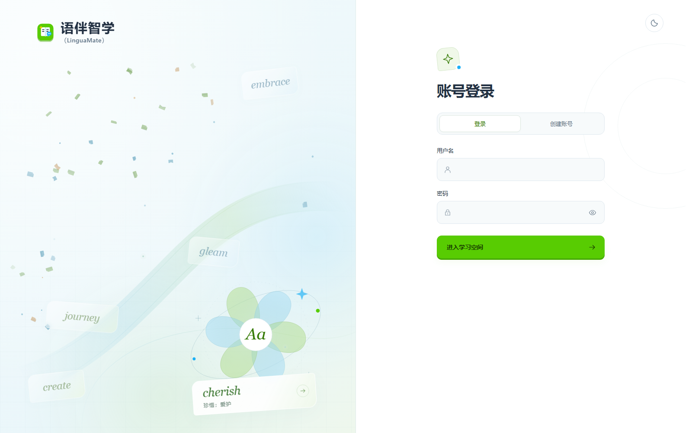

### 黑夜模式

学习工作区提供亮暗主题，可从顶部切换。

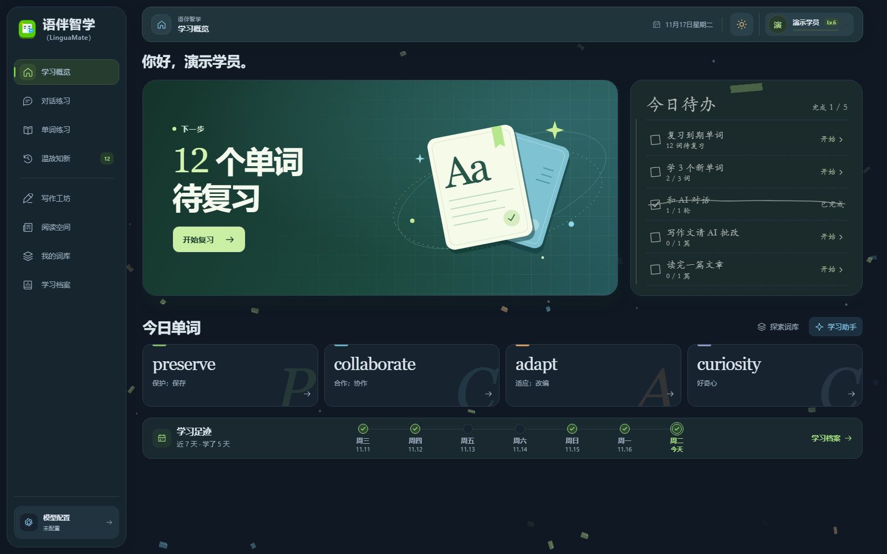

</details>

<details open>
<summary><strong>词汇练习与复习</strong></summary>

### 单词练习

在例句中判断目标词义，底栏集中显示答题反馈、深度解析和下一题入口。

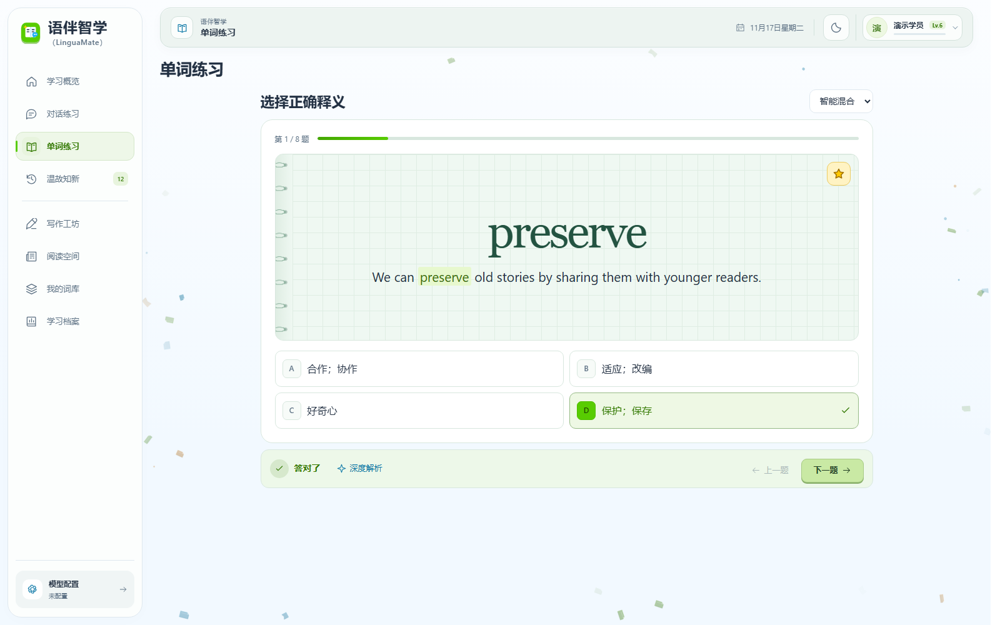

### 温故知新

在例句中填空，分别回忆拼写和释义。

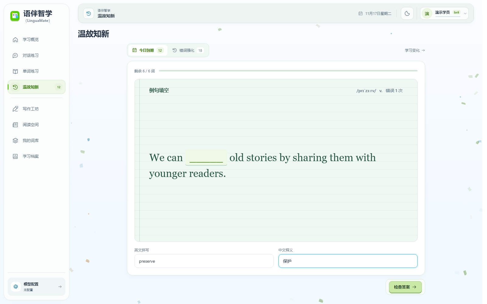

### 我的词库

集中查看收藏单词和复习状态，可进入单词详情。

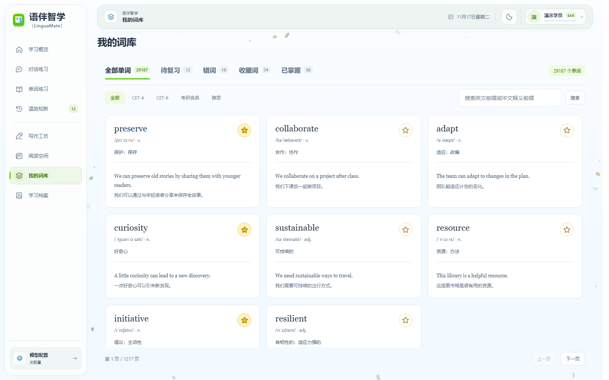

</details>

<details open>
<summary><strong>对话、写作与阅读</strong></summary>

### AI 对话

对话和反馈并列，回看某一轮时可以查看参考表达和修改原因。

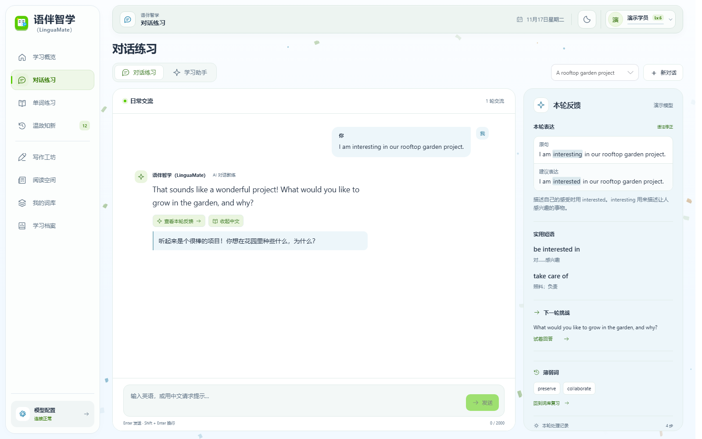

### 学习助手

可以直接问「只有五分钟，先练什么」，结合复习进度进入对应的练习。

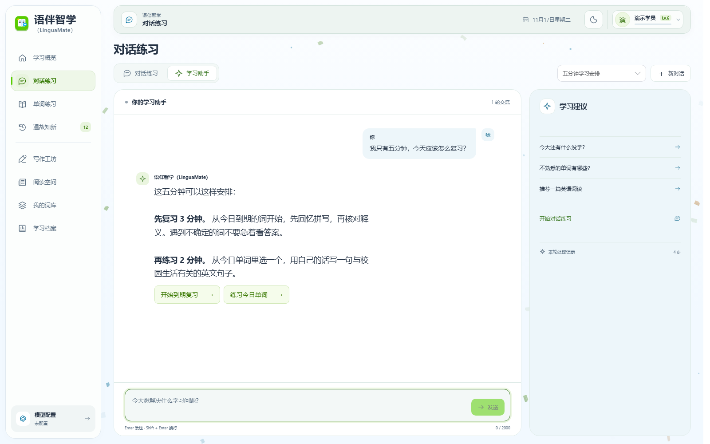

### 写作工坊

提交英文习作后，可以在同一页面查看批改反馈和参考表达。

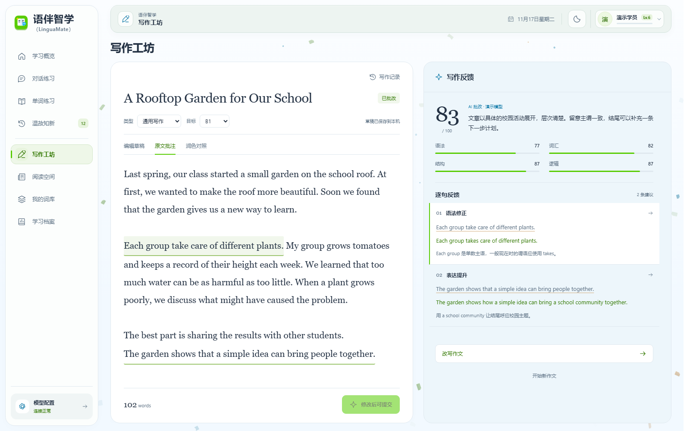

### 阅读空间

在文章内查看原文、查词和学习进度。

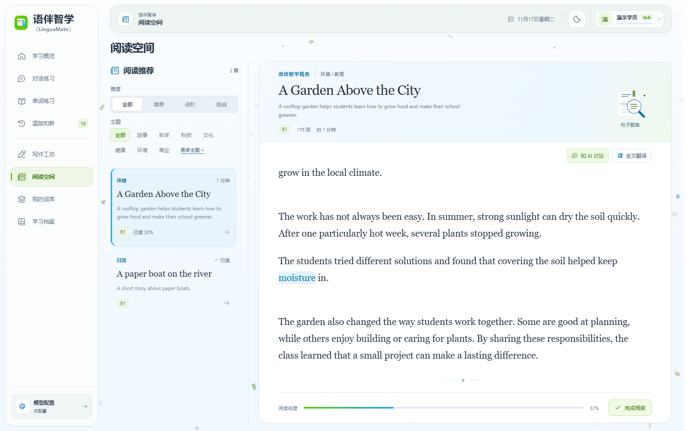

</details>

<details open>
<summary><strong>学习档案与成长证据</strong></summary>

### 学习档案

趋势、月度日历和学习成果集中展示。点击日期可查看当天记录，左右箭头可切换月份。

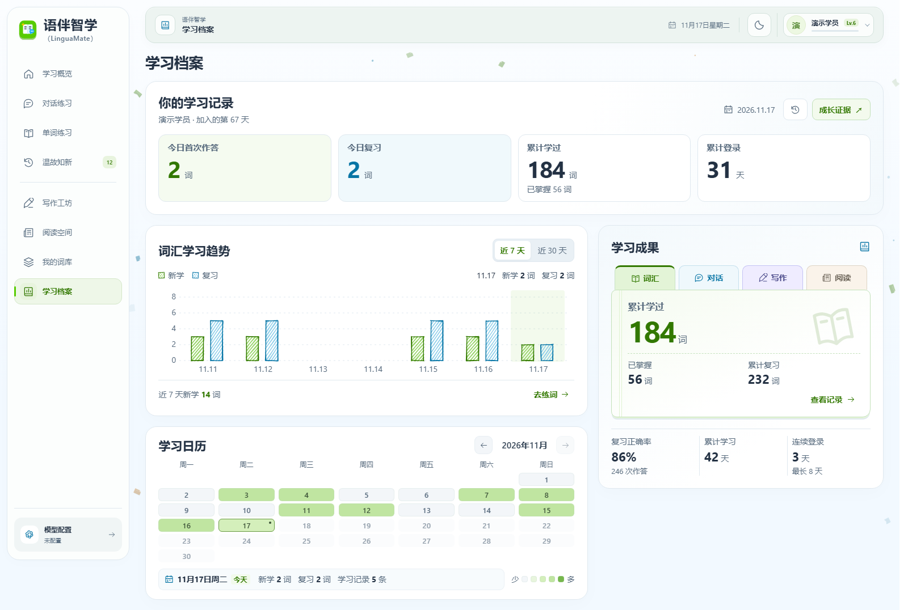

### 成长证据

左侧浏览近期记录，右侧对照具体答案、表达或提交版本。

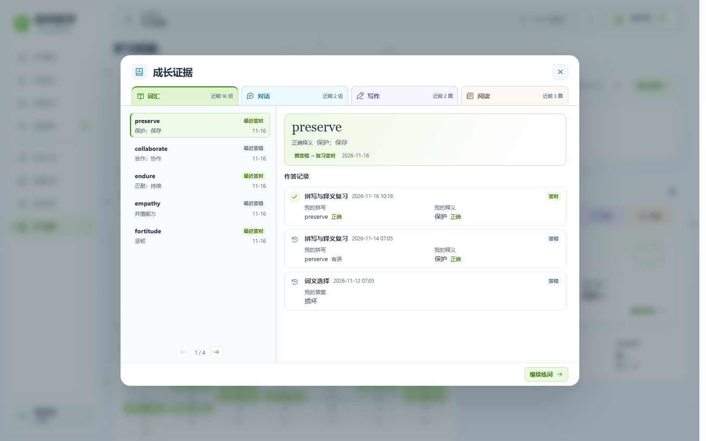

</details>

[截图索引与历史版本](docs/images/README.md)

## AI 如何参与学习

- **对话** · 以「日常交流」为例，学习者用英语回答，教练根据本轮原句给出更自然的参考说法、解释改动，并提供下一轮可以尝试的表达。消息的中文译文按需展开。
- **写作** · 批改会保留提交原稿、修改建议和参考稿。学习者自行修订并再次提交后，才形成自己的新版本。在同一评分设置下，可查看两次评分的变化。
- **学习助手** · 根据问题、近期对话、今日学习进度和薄弱词组织建议。需要回看依据时，可查看 Agent 的 Observe、Think、Act、Answer 执行记录。
- **知识检索** · 后端将知识文档切分为片段，再按照问题里的关键词召回相关内容，连同必要的学习上下文一起提供给模型。实现细节见 [Spring AI 与 RAG 说明](docs/SPRING_AI_AND_RAG_NOTES.md)。
- **本地可用性** · 注册登录、词库、复习、学习记录和内置文章使用本地服务。在线模型不可用时，对话练习和写作批改提供带明确标记的本地反馈。评分为练习参考。

## 快速启动

### Windows 一键启动

要求 Java 17+、Node.js 20.19+ 或 22.12+、MySQL 8。首次构建需联网下载依赖。

```powershell
git clone https://github.com/bulangya-bu/linguamate-agent.git
cd linguamate-agent
```

如果这台电脑已有可用数据库，可预先设置 `DB_URL`、`DB_USER` 和 `DB_PASSWORD`。如果已安装 MySQL 8 且需要初始化项目专用实例，先执行下面的命令，后续可复用本机加密凭据。

```powershell
powershell.exe -NoProfile -ExecutionPolicy Bypass -File scripts/setup-local-db.ps1
```

```powershell
.\start.cmd
```

1. 浏览器打开 [本机学习入口](http://127.0.0.1:5173) 后，点击「创建账号」注册，或使用本地演示学生账号 `student / student123`。
2. 想使用在线反馈时，在左下角「模型配置」填写 OpenAI 兼容接口地址、密钥和模型名称，再进行连接测试。
3. 回到「学习概览」，任选一项开始。完成后可到「学习档案」查看活动或原始记录。

脚本默认将网页运行在 `5173`、API 运行在本机 `4040`。同一局域网的设备可使用 CMD 显示的 `LAN` 地址访问网页。只在本机使用时，可按 [本地配置示例](scripts/local.config.example.ps1) 设置 `FRONTEND_HOST=127.0.0.1`。在首次创建管理员账号时，通过后端环境变量 `LINGUAMATE_ADMIN_BOOTSTRAP_PASSWORD` 提供 12–64 位新密码。

```powershell
.\stop.cmd
```

停止脚本关闭前端和 API。MySQL 独立保存数据，本机配置信息与运行日志位于 Git 忽略的目录。

### Docker Compose

在支持 Docker Compose 的终端运行。以下命令以 PowerShell 为例，请使用自己的数据库密码。

```powershell
$env:DB_PASSWORD = '<你的数据库密码>'
docker compose up -d --build
```

Compose 启动前端 Nginx、Spring Boot API、MySQL 与 Redis。网页默认在 [5173 端口](http://localhost:5173)。端口、跨域、模型与部署配置见 [部署说明](docs/DEPLOYMENT.md)。

## 开发与测试

### 架构

```text
浏览器
  └─ Vue 3 / Vite（开发）或 Nginx（Docker）
      └─ /api → Spring Boot
          ├─ 账号、词汇、阅读、写作与学习档案 → MySQL
          ├─ 学习 Agent 与轻量知识检索
          └─ 可选 OpenAI 兼容模型与 Redis 缓存
```

前端使用 Vue 3、Element Plus 与 Rough.js。后端使用 Java 17、Spring Boot 3.5.3、MyBatis-Plus 和 Maven Wrapper。浏览器经同源代理请求 API，前后端可独立启动、构建和部署。

### 分开启动

先设置后端所用数据库的环境变量。在项目根目录启动 API。

```powershell
.\mvnw.cmd spring-boot:run
```

另开一个终端，在项目根目录执行。

```powershell
cd frontend
npm ci
npm run dev
```

Vite 默认把 `/api` 代理到 `http://127.0.0.1:4040`。需要不同上游地址时，参考 [前端配置示例](frontend/.env.example)。

### 测试与构建

在根目录用隔离的测试数据库配置运行后端测试。MockMvc 集成测试不需要真实模型密钥。

```powershell
.\mvnw.cmd test
.\mvnw.cmd package
```

在 `frontend/` 目录运行前端测试和构建。构建产物输出到 `frontend/dist/`，可用 `npm run preview` 本地查看。

```powershell
npm test
npm run build
```

### 目录

| 路径 | 用途 |
| --- | --- |
| [frontend/src](frontend/src) | Vue 页面、组件、前端业务模块与 API 客户端 |
| [src/main/java/com/example/javabigwork](src/main/java/com/example/javabigwork) | Spring Boot API、Agent、鉴权、词汇、写作、阅读、报表及后台管理 |
| [src/main/resources](src/main/resources) | 数据库结构、内置数据、词库与应用配置 |
| [src/test](src/test) | 后端单元测试及 MockMvc 集成测试 |
| [scripts](scripts) | Windows 启停、数据库初始化与本地配置 |
| [docs](docs) | 部署、架构、学习工作区、测试说明和页面截图 |

## 进一步阅读

- [项目架构](docs/PROJECT_ARCHITECTURE.md)
- [学习工作区说明](docs/LEARNING_WORKSPACE.md)
- [架构审查](docs/ARCHITECTURE_REVIEW.md)
- [测试报告](docs/TEST_REPORT.md)
